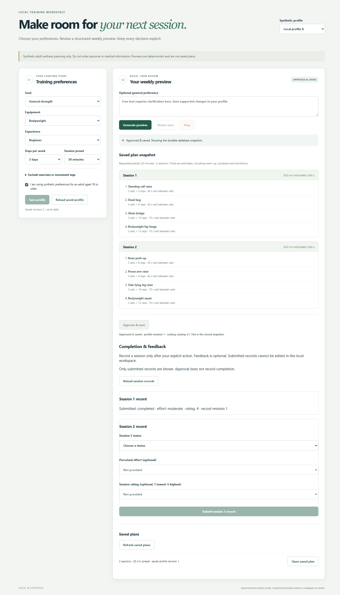

# Future Adaptive Training Agent

A local workout-planning application built to make agent decisions inspectable
and human approval explicit. Save structured training preferences, stream a
validated weekly proposal, revise it once, then approve an immutable saved plan.

**Current release scope: offline, synthetic adult examples only.** The application
uses a deterministic fake provider. A separate experiment exercises counted
Responses replay, accounting and evaluation. Real-model quality, independent human
judgments, clinical effectiveness and production deployment have not been established.

This is the curated, source-only [portfolio repository](https://github.com/ThePhysic/adaptive-training-agent).
Its accepted F5-D10 source was uploaded privately; the original development
repository and its historical/private records are preserved separately.

<details>
<summary>View the verified local workspace</summary>



</details>

## What it demonstrates

- **Bounded agent execution:** typed read tools, structured output, independent
  domain validation, one semantic repair, deadlines, token and concurrency limits.
- **Streaming with a safe terminal boundary:** an incomplete preview cannot be
  approved. Stop/disconnect cancels owned work; generation never silently reconnects.
- **Human control:** Save, revision, approval and session submission are explicit.
  Only a complete validated proposal can enter the approval transaction.
- **Durable approval:** PostgreSQL commits snapshot, idempotency result and audit
  atomically. Lost responses recover with the same key; profile changes do not
  rewrite approved history. Approval does not imply session completion.
- **Operational evidence:** real Chrome/React/FastAPI/PostgreSQL tests, readiness,
  non-root containers, migration checksums, scoped restart and backup/restore drills.
- **Evaluation integrity:** a shared hard scorer, retained intermediate failures,
  durable first results, synthetic count/generation liabilities, blinded practice
  packets and dummy-only review imports. Unknown costs and missing judgments stay unknown.

## Architecture

React 19 / TypeScript → one loopback FastAPI process → typed Python orchestration,
read tools and validator → transient candidates → explicit PostgreSQL approval.
Python 3.14, PostgreSQL 18, uv/npm locks and digest-pinned Docker bases support local
reproduction. FastAPI serves the built frontend; no Redis, queue or separate
frontend service is required. LangGraph and Langfuse SDK work remain isolated experiments.

See the [architecture and design tradeoffs](docs/architecture.md) and
[claim-to-evidence map](docs/engineering-evidence.md).

## Try the local demonstration

Use an installed locked environment, Docker's Linux engine with the cached
PostgreSQL image, and installed Chrome. No provider credentials or AWS access.

```powershell
docker compose up -d --pull never --wait postgres
npm.cmd --prefix web run build
$env:FATA_BROWSER_EXECUTABLE = 'C:/Program Files/Google/Chrome/Application/chrome.exe'
$env:FATA_BROWSER_EVIDENCE_STAGE = 'f5-d1'
Remove-Item Env:FATA_WRITE_EVIDENCE -ErrorAction SilentlyContinue
.venv/Scripts/python.exe -m pytest tests/test_browser_ui.py -q -s -m integration --basetemp=.cache/portfolio-browser
```

The real browser performs Save → generate → revise → approve → lost-response
recovery → durable readback → refresh → owner isolation. It uses a disposable SQL
schema, not the existing application records. Read the
[complete demonstration runbook](docs/local-demonstration.md) first for environment
flags, cleanup, supported platforms and a separate hands-on container window.
Fresh screenshots go to ignored `.cache/browser-evidence/<UUID>/` directories.
The successful harness JSON reports their relative paths in `screenshots`; tracked
historical PNGs are preserved.

First-time setup requires dependency/image acquisition; it is not an air-gapped
install. Use the pinned [setup instructions](docs/runbook.md#acquire-the-pinned-environment-once).
See the [four-minute recording guide](docs/portfolio-walkthrough.md) for presentation.

## Evidence and reproducibility

F5-D1 demonstrated the integrated application twice and exercised native
recovery/restore. Its accepted historical evidence records **2,598 distinct selected Python
tests**, **131 frontend tests**, the frozen **40/40** software baseline and **150/150**
expected template/fake/replay handling dispositions. Counts establish tested
software behavior, not fitness benefit or model quality.

The local fake-provider workload recorded 120 generations without errors. Its
[measurement and caveats](docs/implementation/f5-d1-report.md#recovery-and-measured-local-operation)
name concurrency, warm-up, timings and host contention; these are not LLM latencies.

```powershell
.venv/Scripts/python.exe scripts/check.py
.venv/Scripts/python.exe scripts/evaluate_baseline.py --check
.venv/Scripts/python.exe scripts/evaluate_models.py --check
```

The shared check runner builds/tests the frontend, checks contracts/lint and runs
the routine offline suite. Native SQL/browser tests and release recovery are
separate opt-ins in the runbook. Accepted F5-D10 [hosted CI](https://github.com/ThePhysic/adaptive-training-agent/actions/runs/40765462914)
passed all mandatory phases at commit
`a74e10c41fca740770428f4fdcff9b9f83c7c5bf`: the installed-browser workflow,
PostgreSQL/HTTP/TLS/fault integration, frontend build, frozen-artifact guard,
isolated SDK checks and container release/restore drill. See the
[phase counts and limits](docs/engineering-evidence.md#accepted-f5-d10-hosted-verification).
These results are separate from overlapping local/historical test populations.
The earlier [F5-D8 run](https://github.com/ThePhysic/adaptive-training-agent/actions/runs/40757298712)
failed its browser-version preflight; its underlying cause remains unknown.
Current [release readiness](docs/portfolio-readiness.md) separates source publication
from deferred runtime distribution and genuine evaluation.

## Boundaries and deferred work

This is a single-process localhost workspace with two synthetic identity selectors,
not production authentication or a public service. Candidate state is transient;
there is no durable generation resume. Free text outside the supported structured
domain can clarify or abstain. Exercise metadata and scheduling constraints have
not been clinically or independently professionally validated.

Live provider calls and financial authority remain denied. Input-count pricing,
retention and account compatibility remain unresolved; synthetic holds are not
provider billing. The planned 20-pair study has no genuine unseen population or
collected human-quality judgments. Final freeze, human-only curation, custody,
opening and real evaluation each need separate approval. AWS is planned, not
operated; hosted observability is disabled and optional.

## Navigate the repository

| Area | Purpose |
| --- | --- |
| `src/future_training/` / `web/` | Application, API contracts, UI |
| `contracts/` / `migrations/` | Approval/provider guarantees and additive SQL |
| `experiments/` / `data/evaluation/` | Isolated synthetic evaluation; exposed fixtures |
| `tests/` / `scripts/` | Offline regressions, builds, demonstrations and source checks |
| [Evidence map](docs/engineering-evidence.md) | Specific claims, tests and evidence types |
| [Engineering history](docs/engineering-history.md) | Historical acceptance and milestone records |
| [Historical publication review](docs/implementation/f5-d2-publication-safety.md) | Dated findings; see [current source readiness](docs/portfolio-readiness.md) for resolved items and remaining scope |

Project-owned material is licensed under the committed [MIT License](LICENSE),
copyright 2026 ThePhysic. Third-party components retain their own licenses; see
[third-party notices](THIRD_PARTY_NOTICES.md) and the
[distribution decision register](_release/F5-D6-LICENSING-DECISIONS.md).
The MIT grant is not conditional on the project's internal approval procedures.
Maintainer-operated provider, spending, cloud and genuine-evaluation workflows
remain separately gated; those controls do not add restrictions to the MIT grant.
This source-only scope does not establish notice/compliance readiness for distributing
bundled dependencies, installed environments or container images.
