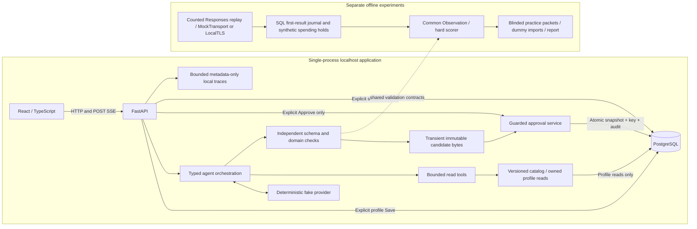

# Architecture of the offline application

This describes the implemented local slice. It is not a production deployment or
evidence of actual model quality. See the [evidence map](engineering-evidence.md).

The experiment journal uses disposable PostgreSQL schemas, not a second database
service. Experiments do not publish application candidates, approve plans or grant
live provider authority. Arrows describe responsibilities, not extra HTTP hops:
internal profile/catalog reads are direct services. There is no Redis dependency.

## Decisions that matter

**One API process and event loop.** Candidate lineage guards, admission and stream
ownership are local. This makes races inspectable and lets disconnect cancel and
await owned tasks. It does not support scaling by adding workers. Production
durable generation or distributed ownership would require a separate design.

**Terminal validity precedes approval eligibility.** The agent may use bounded
read tools and repair once, but schema parsing alone does not establish a feasible
workout. The domain validator independently checks supported equipment, exclusions,
prescriptions and duration. Only complete validated `done(plan)` publishes a
candidate; HTTP 200, a preview or stream EOF alone is insufficient.

**The approval transaction is the write boundary.** The service checks synthetic
owner, candidate identity/revision/hash, expiry and saved-profile revision under
the appropriate guards. PostgreSQL serializes durable key/snapshot/audit writes.
Commit is the approval linearization point. Reconciliation preserves uncertain
outcomes; choosing another key is not recovery. Plans and submitted session records
remain immutable when preferences change. Models have no write/approval tool.

**Application fake mode and provider replay are distinct.** The normal app uses
its deterministic fake path. Separate HTTPX mock/local TLS experiments exercise
Responses counting, continuation, repair and durable accounting. They preserve
3-count /3-generation /6-combined operation ceilings and unknown liabilities.
No credentials or environment flags can bypass the independent live/financial
denials. An implemented dormant connector is not operational provider access.

**One evaluator, explicit provenance.** Template, fake and replay observations use
the common scorer. Earlier invalid proposals, tool rejections and missing evidence
remain hard failures even after a valid final output. E9's first result is durable;
E10's accepted dummy judgment cannot be replaced by a new label or output path.
Dummy means and synthetic accounting never become genuine human or billing evidence.

**Observability without content export.** Fixed metadata, status, counters and
timings correlate local stages. No prompts, profiles, workout bodies, credentials,
reasoning or private billing identifiers enter approved tracing sinks. The ring is
bounded and ephemeral; it is not a complete durable audit log. Hosted export is off.

**Minimal local operations.** A non-root read-only image serves the built frontend
and backend; a separate PostgreSQL container uses loopback. Dependencies are locked,
images digest-pinned, migrations checksum-verified and explicit. Docker Desktop's
host-network feature is a prerequisite for container release, not something these
instructions enable. A compatible image switch does not undo schema migrations.

See [approval safety](../contracts/approval-safety.md),
[provider safety](../contracts/provider-safety.md),
[domain contract](planning/12-f0-domain-contract.md) and
[local release/recovery](local-release.md). Historical proposals and framework
spikes remain in their own documents; they are not runtime dependencies here.
