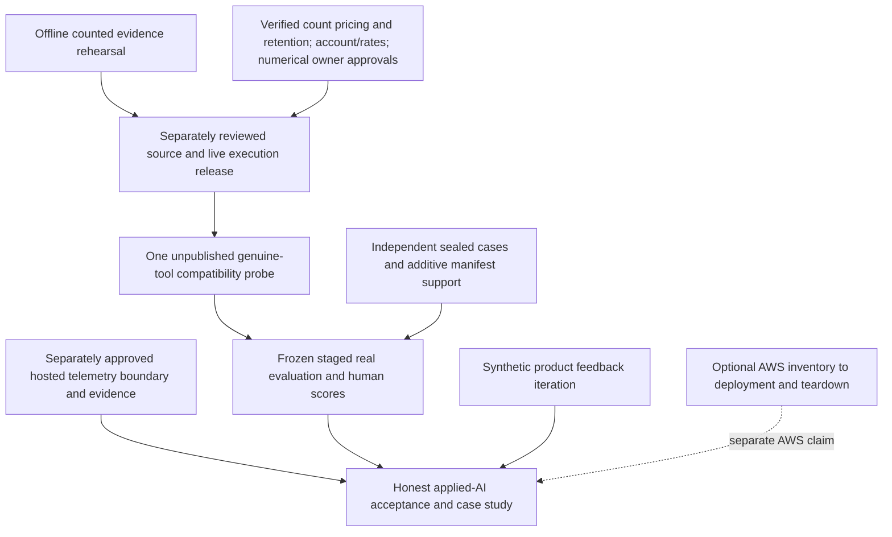

# F4 readiness, remaining scope and critical path

2026-10-27. **Read-only assessment; documentation only.** No AWS/CLI, private
identity/configuration/cache/capture inspection, external request, executor,
installation, infrastructure, source/test change, commit or push. No historical
record or one-shot claim is changed. This document proposes work, not authority.

## Decision

The local application and operations evidence is substantial. The shortest path
to the original applied-AI evidence goals is now **real-model compatibility and
evaluation, human review, and a real observability integration**, subject to their
separate gates. More IAM discovery does not advance those prerequisites.

Pause additional AWS work by default; do not change any AWS protection or claim.
The original F4 phase explicitly permits local operations without cloud spending.
Actual deployment remains necessary **if claiming operated-AWS experience**. This
is a sequencing recommendation, not cancellation of that optional learning track.

Recommend one bounded next implementation: **F3-E1 (proposed name), Offline
Counted-Probe Evidence Rehearsal**. Connect the existing count-aware, unpublished
probe's observed behavior to the existing common scorer and manifest, using only
synthetic SQL/mock/TLS fixtures. Do not add another evaluator, live collector CLI,
transport or permit. The [backlog and milestone specification](f4-remaining-scope-backlog.md)
give scope, acceptance, dependencies and effort. Implementation is not authorized
by this assessment.

## Original goals and precedence

The source of the role mapping is the project's accepted charter, not an
independently verified current employer job advertisement:

- [Charter 00, role coverage and completion labels](../planning/00-charter-and-requirements.md):
  bounded adult general-wellness planning, typed Python/async APIs, genuine model
  tools and structured output, streaming, explicit writes, meaningful evaluation,
  tracing, defended framework/performance choices, optional AWS operation and
  honest product evidence. No medical or fitness-effectiveness claims.
- [Phases 02](../planning/02-phases-and-acceptance.md) and
  [reconciled decisions 08](../planning/08-reconciled-decisions.md): F1 local
  correctness is valid evidence; broad Future-targeted applied-AI claims require
  a real model tool/structured-output experiment and an actual tracing/evaluation
  integration. F3 needs human scores and declared denominators; a judge is optional.
- [D01–D12 and gates 04](../planning/04-decisions-risks-costs.md): modular monolith,
  PostgreSQL business authority, transient candidates, fake first, no production
  graph/cache without evidence, separately approved spending/export/pilot.
- [Domain 12](../planning/12-f0-domain-contract.md),
  [lifecycle 13](../planning/13-f0-candidate-approval-contract.md),
  [SSE/budgets 14](../planning/14-f0-remaining-contract-clarifications.md), and
  [F1 package 09](../planning/09-f1-work-package.md) remain authoritative for
  supported rules, explicit writes, ordering, cancellation and request bounds.
- Later approved contracts refine implementation: [provider safety](../../contracts/provider-safety.md),
  [offline amendments 18](../planning/18-proposed-token-admission-amendment.md),
  [readiness 19](../planning/19-f3-03c-pre-live-readiness.md),
  [evaluation 20](../planning/20-f3-model-evaluation-protocol.md),
  [Langfuse 21](../planning/21-f3-langfuse-offline-integration.md),
  and [AWS runbook 26](../planning/26-f4-aws-validation-and-deployment-runbook.md).
  None independently authorizes execution.

Some original planning/README headers still say proposed/pending; the current
owner instruction and accepted completion trail establish F0–F2 and subsequent
offline scopes. Conversely, a newer offline acceptance does not erase an earlier
live NO-GO. README/checklist snapshots are not a current account inventory.

## Evidence key and status rules

**PASS** means the specifically bounded requirement has recorded evidence, not
production readiness. **PARTIAL** means only part of that requirement is evidenced.
**BLOCKED** means an explicit prerequisite prevents its next required operation.
**NOT STARTED** means no execution/implementation evidence for the named capability.
Historical tests were not all rerun for this documentation task.

| Evidence | Repository source and evidence class |
| --- | --- |
| E1 | [F1 acceptance](f1-acceptance-report.md): historical 504 routine +73 integration Python, 69 frontend; six routine reference-model cases distinguished from actual PostgreSQL; installed-browser journey and local failure traces |
| E2 | [F2 acceptance](f2-acceptance-report.md): historical 604 routine +105 integration Python, 85 frontend, separate 47 graph tests; SQL completion/restart and browser evidence |
| E3 | [Async audit](f2-01-async-audit.md)/[handoff](f2-01-handoff.md); [cache decision](f2-02-cache-decision.md); [graph comparison](f2-03-handoff.md): measured controlled I/O, rejected application caching and actual local checkpoint/process restart |
| E4 | [F3-03D](f3-03d-handoff.md), [F3-04C](f3-04c-handoff.md): native SQL mixed liabilities/discrepancies, count-aware local TLS, fixed unpublished assembly and empty live-authority namespace; provider behavior unverified |
| E5 | [F3-04A](f3-04a-handoff.md)/[protocol 20](../planning/20-f3-model-evaluation-protocol.md): 50 authored cases, common hard scorer, exposure audit, blank blinded packets; zero real model/human/judge observations |
| E6 | [F3-05A](f3-05a-handoff.md): historical 980 routine +257 integration, 85 frontend, separate 16 socket-sealed SDK and 47 graph; 150 comparisons, 738 captured offline observations, 300 software scores; no hosted ingestion |
| E7 | [F4-01](f4-01-handoff.md)/[release evidence](evidence/f4-01-release.json): real local Docker/HTTP/PG restore, immutable record/key consistency, compatible-image switch, 120 fake generations; not AWS |
| E8 | [F4-02](f4-02-handoff.md), [F4-03A](f4-03a-handoff.md), [infrastructure specification](../portfolio-readiness.md) (curated release-readiness substitute; original infrastructure reference omitted): Terraform/mock plans, local host/storage/network tests and operator recovery; not AWS runtime |
| E9 | [Readiness 23](../planning/23-f4-03-cloud-execution-readiness.md)/[R3](f4-03b-r3-handoff.md): bounded read-only account facts and one real identity-only provider plan; private postconditions accepted, coordinator warning separate; not an infrastructure plan |
| E10 | [A1a](f4-a1a-completion.md)/[A1b](f4-a1b-completion.md), [state-01](f4-a2-state-01-completion.md)/[state-02](f4-a2-state-02-completion.md): owner-attested identity/metadata only; MFA/request count unverified |
| E11 | [State-03 stop](f4-a2-state-03-stopped-observation.md), [managed stop](f4-a2-group-managed-01-stopped-observation.md), [postmortem](f4-a2-group-managed-01-postmortem-handoff.md): retained owner observations and unknown failure, not successful managed inventory |
| E12 | [Boundary handoff](f4-state-operator-boundary-handoff.md) and [syntax follow-up](f4-boundary-python-syntax-follow-up.md): tested local proposal, not evidence of an installed/effective AWS boundary |
| E13 | [Diagnostic integration](f4-a2-group-diagnostics-integration-handoff.md): last accepted selected 512 tests; no current full-suite/cloud inference |
| E14 | This task's fresh no-write checks, listed in the [handoff](f4-readiness-reassessment-handoff.md): baseline, model assets/common scorer, contract drift, source grammar/integrity; not application/browser/SQL reruns |

Counts from different revisions/environments are separate populations, never a
sum of independent quality trials. Owner acceptance/attestation is labelled;
Codex has not reproduced any live identity or inventory operation in this task.

## F0–F4 evidence/status matrix

| Capability / original requirement | Existing implementation and evidence | Status | Remaining work | Live AWS required? |
| --- | --- | --- | --- | --- |
| F0 architecture, domain and write contracts | 00/08/09/12–14; accepted owner trail; exact matrix/durations/lifecycle and limits | PASS | Preserve; no architecture restart | No |
| F1 typed Python API and versioned schemas | FastAPI/Pydantic, OpenAPI/TS workflow; E1, fresh contract check E14 | PASS, local | Routine regression at future code changes | No |
| F1 catalog, independent validation, baseline | 20 records/eight rows/three durations; validator and template; E1/E14 | PASS, software | No fitness-safety or qualified content-review claim | No |
| F1 profile/ownership/candidate lifecycle | Loopback synthetic two-principal boundary, explicit Save, TTL/revisions/guards; E1 | PASS, local | Real authentication only before external users | No |
| F1 typed tools/orchestration/budgets | Read-only tools, repair/retry/deadline/admission, fake provider; E1 | PASS, fake | Real tool selection is separate F3 gap | No |
| F1 SSE, narrow UI and review/revision | Four terminals, strict parser, terminal-only publication, cancellation; E1/E7 | PASS, local | No provider-stream or browser-population claim | No |
| F1 atomic approval/read/history | Owner-scoped SQL snapshot/key/audit, guard/profile ordering, cancellation-safe reconciliation; E1 | PASS, tested one process | Physical crash/scale/production trust remain outside scope | No |
| F2 async parallelism and failure handling | Controlled independent HTTP overlap, child cleanup, one retry owner; E2/E3 | PASS, local/fake | No external-service scale inference | No |
| F2 measured caching choice | Real catalog profiling, prototype invalidation/capacity/concurrency, uncached app retained; E3 | PASS | Adding a cache is not a missing requirement | No |
| F2 stateful framework learning | Isolated LangGraph/SQLite interrupt, process exit/restart/resume; E3 | PASS | No production graph adoption needed | No |
| F2 explicit completion/feedback | Owned immutable session Submit, actual SQL keys/concurrency/restart; E2 | PASS, synthetic | Actual user usefulness/product iteration not established by stored records | No |
| F3 provider/schema/stream integration | Count-aware Responses, native items, schema projection, strict local TLS, validator; E4 | PASS, offline | Real provider schema/continuation/usage/latency compatibility unverified | No; separate provider access |
| F3 admission and financial authority | 3-count/3-generation/6-combined, immutable payloads, durable holds/freezes, both hard denials; E4/19 | BLOCKED for live | Count tariff/bound/retention, rate/account evidence, live amendment and source/execution approvals | No |
| F3 evaluation machinery | Common scorer, 50/150 synthetic assets, 40 frozen cases, manifests/rubric/packets; E5/E14 | PASS, offline | Counted-probe evidence bridge and genuinely sealed population support remain | No |
| F3 genuine tools, quality and human comparison | Only authored template/fake/replay and one owner-reported manual count of 18 | BLOCKED | One authorized compatibility probe, then frozen live evaluation/human ratings and failure report | No |
| F3 local tracing and SDK exercise | Metadata correlation, canaries, induced fault, isolated Langfuse SDK; E1/E6 | PASS, local | Provider latency/cost are not simulated timings | No |
| F3 actual hosted tracing/evaluation integration | Projection and activation specification only; E6/21 | NOT STARTED | Separate reviewed export boundary, region/retention/cost/outbound approval, actual ingestion/query/deletion evidence | No |
| F4 local release, readiness and recovery | Pinned nonroot image, loopback, migrations, failure/restore/image-switch drills; E7 | PASS, local | Re-run for the eventual release revision; not arbitrary schema rollback or cloud RTO | No |
| F4 measured latency/performance | 120 fake generations plus cold/warm prototype comparison, resource observations; E7 | PASS, bounded | No real-model/production speed or availability claim | No |
| F4 CI | Pinned mandatory browser, SQL/TLS, contracts, release drill; earlier hosted run in E9; owner later reported R5A CI passed | PARTIAL for exact current tree | Retain hosted run/revision evidence when owner later chooses to publish; no trigger now | No |
| F4 IaC, host isolation and AWS design | Terraform 1.17.0/provider 6.70.0, EC2/SSM, six-resource local-state bootstrap; E8/E12 | PASS, offline design | Real AMI/images/identity/backend/plan/runtime still gated | Only for real-cloud verification |
| F4 state-user effective authority | A1a/b identity; zero direct managed/inline user policies; one unapproved group observation; E10/E11 | PARTIAL | Inherited policy classification/body/context, current boundary and resource-policy review remain unknown | Yes, or fresh authoritative owner evidence for the cloud branch |
| F4 installed boundary and real S3 backend | Local policy proposal/mock backend only; E12 | NOT STARTED in AWS | Validate real policy/install under separate approvals; actual 403/404, default workspace, lock/version behavior | Yes |
| F4 operated AWS deployment/restore/teardown | No EC2 app, state bucket, actual infrastructure plan or apply evidence | BLOCKED, optional track | Complete cloud-specific authorization/identity/state/image/cost/plan/deploy/recovery/teardown gates | Yes |

F5 is adjacent, not silently dropped: [phase 02](../planning/02-phases-and-acceptance.md)
requires a candid case study and product hypothesis/measurement/change/follow-up.
Completion/feedback storage is not that study. Synthetic scripts/screenshots exist;
an actual observed human feedback iteration is **PARTIAL/not evidenced**. A 3–5
external-adult pilot is optional and remains blocked by real auth/privacy/content
review gates. No need to build production authentication merely to finish a local
synthetic case study.

## What F4 does and does not need

F4's core gate is local build/release/rollback, restore, measured workload and
operational runbooks. E7 records two clean builds with identical 75-file payloads
and versions, not bit-identical OCI images. Actual restore verified one approved
plan/key/audit and one completion/key, with nine migrations. Compatible images
used the same schema; image rollback does not reverse schema. Reported dump/restore
command timings are not end-to-end RTO.

The 120 fake generation samples were 60 at concurrency one and 60 at concurrency
two, zero errors. Recorded p50/p95: 51.481/98.546ms and 74.183/156.092ms. First SSE
status is progress, not model-token latency or browser paint. These are historical
F4-01 laptop/container measurements, not current load tests or production claims.

The optional cloud branch has real dependencies that must not be skipped if chosen:

| Activity | Need more IAM/S3 evidence? | Can proceed offline now? |
| --- | --- | --- |
| Application, evaluation, local telemetry/recovery work | No dependency on state-user effective permissions | Yes, after specific implementation authorization |
| Review generated boundary and Terraform/host policy tests | No AWS account access for static/synthetic verification | Already largely done; extend only for a concrete defect |
| Boundary creation/attachment and state grants | Yes: exact target/current boundary, applicable identity/group policies and policy body; approved findings and change ordering | Proposals only; no install or grant |
| Human-admin one-time S3 bootstrap | Exact reviewed six-resource plan, human authority/account/MFA-risk/window/budget; runbook 26 orders prior IAM/boundary checks | Offline plan guard exists; real plan/apply are different approvals |
| State-user backend init/lock/state access | Yes: bound state identity, approved grants/boundary, exact bucket ownership/region and actual S3 behavior | Mock compatibility only; genuine service result needed later |
| EC2 deployment/provider plan | Separate nonadmin provider authority plus state backend, AMI/tools/images/AZ/cost review | Design/preparation only |

Do not turn inventory into a universal project dependency. Its value is **bounded
cloud authorization discovery**: identify inherited authority, close named policy
bodies/versions, verify current boundary and avoid unsafe grants. Metadata alone
does not prove effective permissions; hypothetical simulation does not establish
actual service/MFA context or all resource grants.

The managed invocation is permanently retained as stopped/uncertain. Diagnostics
do not explain or reopen it. Inline remains offline prepared. Further reads, if
ever desired, need a new independently reviewed objective and authorization;
this assessment proposes no immediate AWS command or retry. Repeating identities,
building an all-account IAM crawler or pursuing OS-wide AWS CLI containment would
not materially improve the currently blocked model-evidence path.

Keep the current cloud controls: preflight read-only; human admin bootstrap only;
old policy-administrator delegation inactive; state user restricted to exact
`ec2-demo/terraform.tfstate` and `.tflock`; provider identity separate. The boundary
is a ceiling, not a grant; no installation is evidenced and current attachment
remains unverified. Its explicit denies address
same-account direct-user grants outside the ceiling; within-ceiling resource grants
can still bypass absent/expired identity grants. Do not remove a boundary as an
automatic rollback or grant state-user provisioning authority.

The retained `s3:prefix=["env:/"]` has native offline workspace-discovery evidence,
not real empty-bucket HEAD evidence. An authorization-dependent 403 is not absence;
do not weaken prefix conditions automatically. Real missing/existing-object,
default-workspace, lock PUT/GET/DELETE, version and ownership checks remain gated.
Provider/backend dual-credential configuration and nonadmin deployment authority
are still unimplemented proposals, not supplied by the identity-only R3 result.

Cost posture is unchanged: no AWS budget is active. The later
[F4-02 cost inventory](evidence/f4-02-costs.json) and
[F4-03A inventory check](evidence/f4-03a-cost-verification.json) supersede the
original topology-A arithmetic for the implemented proposal: historical gross
estimate approximately $1.55866 for its 24-hour/retained-artifact assumptions,
and $3.183023/month retained after instance termination. These are **dated
estimates, not current quotes, enforceable maxima or bills**. Retained EBS, ECR,
S3 versions and AMI snapshots need explicit retention/deletion review. The state
bootstrap's proposed $0.05 gross/$0.02 stop thresholds are neither active nor
enforceable AWS caps. Owner-reported Free-plan/$100 credits do not authorize spend
or prove future service availability/expiry. Do not upgrade the account or refresh
billing/account evidence in this task.

## F3 blockers: current rather than historical interpretation

| Issue | Already demonstrated offline | Still blocking real evidence / safe offline work |
| --- | --- | --- |
| Real input admission | Immutable count/generation binding; fresh count per continuation/repair; 3/3/6 and original 16k/4k, 30s, four tools, one retry/repair, 1-principal/2-global bounds | Not an unsolved need for a new tokenizer. Actual provider count-to-usage equality/schema/native continuation remains unverified; amendments are offline-only. Keep both denials. Rehearse existing counted evidence offline. |
| Counting charges | Paired reservations, held successful counts, unique claims, unknown costs/restart/freeze logic | Endpoint-specific tariff, maximum liability including errors/uncertainty and billing evidence unavailable. Manual count 18 and support escalation establish none. No zero default or positive permit. |
| Generation pricing/cache/model | Exact fractional accounting, upward microdollar rounding, discrepancy freeze and numerical observations | Dated reviewed rates are assumptions, not current invoice proof. Unexpected tier/model/cache writes stay unpriced and stop. Reverify terms/rates before any proposal for activation. |
| Durable accounting | Native PostgreSQL fault/concurrency/uncertain-commit tests, separate replay and empty live authority | SQL reconciliation is not provider invoice reconciliation. Retain unknown sent costs; cancellation/timeout is not refund. Positive live issuance remains deliberately unexecuted. |
| Data handling | Synthetic-only payloads, request-local encrypted native state, metadata allowlists/canaries | Count-specific retention/training/abuse/cache/deletion/region terms unresolved. Generation store=false is not a counting/ZDR guarantee. Owner review required. |
| Transport/operation | Exact HTTPS endpoint/method/port, TLS, no redirect/proxy/retry, one-shot send proof, revoke/stop and local TLS tests | Real provider branch and account/project access still need separate source/execution approval. Fixed SingleProbe stays unpublished; no arbitrary real-model app route. |
| Evaluation provenance | Common scorer accepts Observation, counts/arguments/domain/terminal checks; 50-case runner and blank human forms | Current runner uses uncounted replay. SingleProbe returns RunResult, not the common evaluator's complete intermediate-proposal/tool Observation. Bridge this narrowly, not by trusting a source='live' label. |
| Sealed comparison | Legacy/exposed labels preserved, rubric and no-score-on-hard-failure rule exist | Zero genuinely unseen cases or collected human judgments. Current Case literals/load_suite accept 40 development/10 exposed rows only; a new sealed manifest needs additive reviewed support, not relabelled v1. |
| Hosted tracing | Actual pinned SDK exercised socket-sealed, source hierarchy/usage aggregate mapping and failure visibility | Hosting/export/deletion/retention/cost approvals and an actual supported export boundary absent. Do not unseal the offline SDK harness. This lane is independent of AWS and counting terms. |

All prices here are **dated repository assumptions**, not refreshed quotes or new
terms verification. Historical conservative generation-run bound: 80,002
microdollars ($0.080002) **across the bounded logical request**, with per-attempt
rounding; it is not multiplied by three again. Total proposal is
`80002 + 3*Cµ`, with independently verified per-count ceiling `Cµ` still unknown.
No numerical live spending authorization can be activated from that formula.

Protocol 20's 69-task population proposal would require at most 207 generation
and 207 counting operations; historical generation arithmetic alone is $5.520138,
already exceeding document 17's old $5 stage proposal before count charges. Do
not execute all populations by default, silently increase limits, or label every
proposed coverage task an original mandatory gate. Predeclare staged case reuse
and denominators, then obtain owner approval for the exact study and real prices.
The 20 quality pairs, declared held-out targets and critical safety gates remain;
any narrower acceptance study requires explicit owner review, not this assessment.

## Dependency-aware critical path

External terms/support delay is unbounded and must not be filled with indefinite
IAM work. Spend that wait on the narrow offline bridge, sealed-study logistics,
genuine owner usability feedback and a bounded case study. Hosted telemetry may
be separately authorized independently of the model/AWS lanes; fake-source hosted
spans would demonstrate actual hosting, not model quality. Real model study and
trace evidence must retain their own provenance.

If provider/export consent or terms never become acceptable, finish and publish
an **offline/synthetic engineering case study** with those unverified labels;
do not claim broad live applied-AI or AWS-operated completion. Formal owner scope
disposition is required to close those evidence goals, not a technical bypass.

## Adversarial review of the recommendation

| Challenge | Disposition |
| --- | --- |
| Are original requirements being lost? | Genuine tools/structured output, human-scored study, real tracing and F5 iteration remain open; graph learning/local recovery are already evidenced. AWS operations remain an explicit conditional track. |
| Are tests substituting for real evidence? | No. Fresh 40/150 checks are software evidence only; no model/human/cloud denominator is invented. Source='live' alone proves nothing. |
| Is a necessary security control postponed? | Cloud IAM/boundary/state controls remain required before cloud use. Provider prices/retention and both source denials remain blocking. No external-user release without real auth/privacy/content review. |
| Is more framework/infrastructure work justified? | Only the demonstrated counted-probe/scorer seam is recommended. No cache, production graph, service, framework, universal executor or broad exporter rework. If existing hooks can close it, reuse them. |
| Can the next milestone stand alone? | Yes: one reproducible local counted run and negative controls become common-scored, provenance-correct evidence, with SQL liabilities and no publication. It does not make live execution GO. |
| Could a final valid repaired plan conceal a failure? | Acceptance must record every intermediate proposal/tool verdict; hard failure remains hard failure even if handling/final validation succeeds. |
| Could held-out work be contaminated? | Existing 50 are exposed; no generation of sealed contents by the developer. Independent curator seals new cases after configuration freeze; absent curator means no held-out claim. |
| Could this assessment authorize a new AWS attempt? | No. Original managed claim/evidence remain untouched; no immediate retry, replacement directory, diagnostic account call or new live approval request. |

Remaining-work classification, effort estimates and the exact proposed next task
are in the [prioritized backlog](f4-remaining-scope-backlog.md). Validation and
review-package provenance are in the [handoff](f4-readiness-reassessment-handoff.md).
